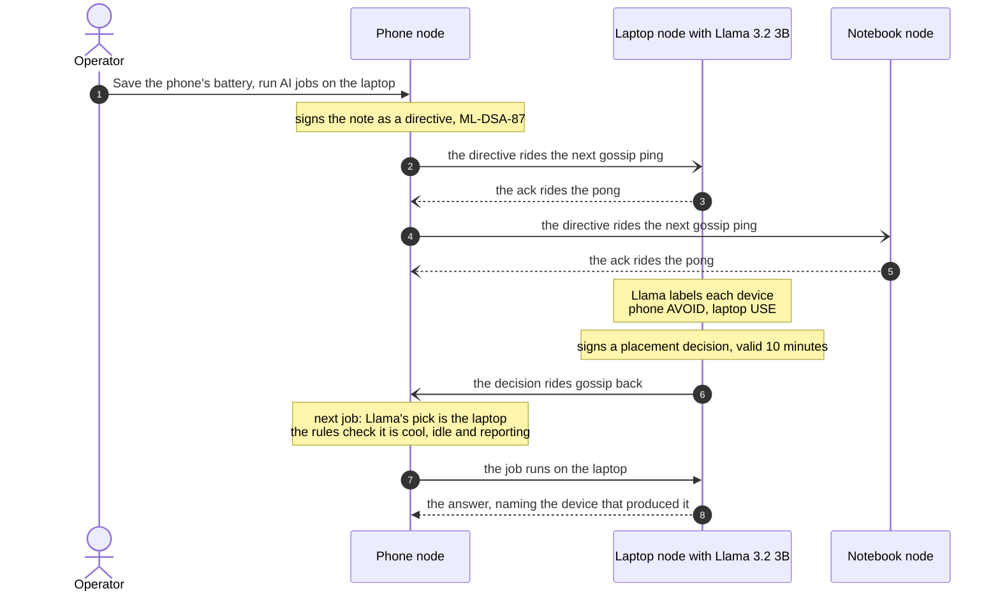
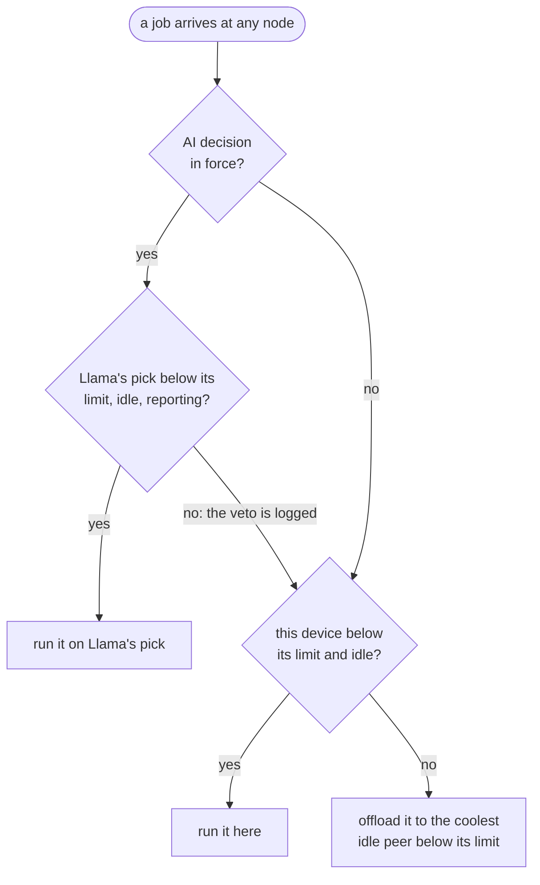

# Harmony

**Your devices already run Llama. Harmony makes them run it together — each job where it should, steered in plain English.**


[See it run](#see-it-run) · [How it works](#how-it-works) · [Meta Llama](#how-harmony-uses-meta-llama) · [Results](#results) · [Dashboard](#live-dashboard) · [Security](#security) · [Quick start](#quick-start) · [OpenAI API](#use-it-from-any-openai-client) · [Tests](#tests) · [Limitations](#limitations) · [License](#license-and-patent-notice)

## The problem: on-device inference dies by heat

Phones and laptops can now run Meta Llama on the device itself: private, offline, and free per token.

But a device that generates for minutes heats up. It throttles, answers slow down, and past a point the job has to stop. Meanwhile the laptop on the same desk sits idle and cool.

And the owner knows things no sensor reports: the phone is about to leave on battery, the laptop is about to join a call.

Harmony turns the devices you already own into one Llama mesh. Each job runs where it should, and you can steer that in plain English.

## The principle: the AI advises; the rules decide

Harmony does not let a language model run the mesh, and it does not ignore what only a language model can read.

- **Llama does the reading.** It reads an operator's note in plain English and labels each device the note mentions USE or AVOID.
- **Code does the arithmetic.** The node — not the model — compares temperatures, limits, headroom and freshness, and places the job.
- **The rules keep the final say.** Llama's pick is used only while that device is below its temperature limit, idle and reporting. Otherwise deterministic rules place the job and the veto is logged.

*The AI advises; the rules decide.*

That division is the whole design. Everything else — thermal offloading, piggyback propagation, signed decisions — exists to make it safe to act on.

## See it run

The phone issues the note and the laptop's Llama reads it. Real output of `scripts/test_harmony.sh intent` on Nov 3, 2026, trimmed and wrapped (the phone at 27.6 °C, the laptop at 47.5 °C, both with a 65 °C limit):

```text
== 1. the note: spare the phone, use the laptop ==
info note: I'm unplugging the phone and heading out for two hours. Save its battery:
           run AI jobs on the laptop instead.
PASS issued directive 41640a6c8801 (signed ML-DSA-87 by 17d9812b3663)
PASS 11048824098a acknowledged it after 6s (ack rode back on the pong)

== at the peer ==
PASS arrived: from 17d9812b3663, 1 hop(s), signature verified at the peer
PASS peer's Llama advisory:
       phone: "I'm unplugging the phone, heading out for two hours, Save its battery" => AVOID
       laptop: "run AI jobs on the laptop instead" => USE
info verdict: llama reads the note: spare phone; use laptop; jobs → laptop (896762541845);
              thermal rules prefer phone (17d9812b3663)
```

The thermal rules alone would have kept the job on the cool phone. Llama's reading of the note moved it: the next job started on the phone was answered by the laptop in 1.7 s.

Then the laptop was restarted with a 43 °C limit, below its real 48.5 °C. Llama's decision was still in force, but the rules vetoed it and the job ran on the phone.

That is the system in one test: a human reason the sensors cannot see changes placement — and a hard thermal limit still overrides the AI.

## What it does

- **Dynamic thermal offloading.** Every node knows each peer's temperature, its thermal limit and whether it is busy. A job that would run hot here runs on the coolest idle device instead, and the answer says which device produced it.

- **Piggyback propagation.** Vitals, signed directives, their acknowledgements and the AI's placement decisions all ride on the gossip pings the mesh already exchanges. Coordination adds no messages of its own.

- **Llama-advised placement.** Leave a note: *"I'm unplugging the phone and heading out for two hours. Save its battery: run AI jobs on the laptop instead."* Meta Llama 3.2, running on a peer, labels each device the note mentions USE or AVOID, and that peer signs the result as a placement decision that rides back on gossip.

- **The rules keep the final say.** Llama's pick is used only while that device is below its temperature limit, idle and reporting. Otherwise deterministic rules place the job and the veto is logged. *The AI advises; the rules decide.*

- **A drop-in OpenAI endpoint.** Every node serves `/v1/chat/completions`, so any OpenAI client or SDK uses the whole mesh as one model.

- **Signed, post-quantum, closed membership.** Links use ML-KEM-1024 and AES-256-GCM; identities, directives and decisions are signed with ML-DSA-87; in strict mode a node talks only to the identities on its list.

## How it works



Every job, on every node, is placed the same way:



### Dynamic thermal offloading

- Each node reads its SoC temperature (`/sys/class/thermal/thermal_zone0` on Linux and Android; the ACPI thermal zones on Windows, without admin rights) and reports it in `/health` as `thermal_c`.
- At or above `--max-temp` (`HARMONY_MAX_TEMP_C`, default 65 °C) a node will not run the model.
- `POST /infer` offloads by default: when this node cannot serve a job (too hot, busy, rate limited) it goes to the coolest idle peer below its own limit, and `offloaded_to` in the response names it. Only capacity failures are offloaded; a bad request would fail the same way anywhere.
- Each node picks a model tier from its RAM and cores, so a 1B notebook and 3B phones and laptops share one mesh; every answer is labelled with the tier that produced it.

### Piggyback propagation

- **Vitals.** Every gossip ping and pong (every 5 s by default) carries the sender's temperature, limit, busy flag and model tier. `GET /peers` shows the latest from each peer.
- **Directives.** `POST /relay` signs a note with the node's ML-DSA-87 identity key. It rides one per ping; the receiver acknowledges it in the pong that answers that ping, so the sender stops carrying it to that peer, and the receiver carries it onward, bounded by 8 hops and 10 minutes.
- **Verified at every hop.** Before it forwards or advises, each node checks that the key matches the origin's fingerprint, that the signature is valid and that the origin is on its own `--cmd-allow`.
- **Thermal-aware.** A hot node still relays (relaying costs almost nothing) but defers its Llama advisory until it has cooled.
- **Wire-compatible.** Empty fields are omitted, so a plain ping is byte-identical to the earlier format.

### Llama reads the note, the node does the arithmetic

- The node finds the devices a note names (by `--label`: whole words, any case), cuts the note into clauses, and quotes for each device the clauses about it. Llama labels each quote AVOID (keep jobs off it), USE (run jobs on it) or ANY. A note that names no device is not sent to the model.
- Among the devices below their limit, with fresh vitals, that the note does not spare, the node takes the rules' pick (idle first, then most headroom) of those the note asks to USE, or of all of them when it asks for none.
- The node that ran the model signs that as a **placement decision** (ML-DSA-87), and it rides back across the mesh on gossip. Single-answer jobs (`POST /infer` with `"fanout": 0`, and every `/v1/chat/completions` request) then go to that device for 10 minutes, or until a newer decision replaces it.
- Each decision records what the rules alone would have picked, so you can see when the AI followed them and when it overrode them for a reason they cannot see, like a low battery or a meeting.
- A decision is adopted only as the answer to a directive the node holds, and only when this node, an `--advisor` or a `--cmd-allow` identity signed it. `"placement": "rules"` in a job ignores decisions.
- `POST /advise` is a dry run: the device's Llama reads a note exactly as it reads a directive, and the answer says where jobs would go. Nothing is signed or issued.

### The rules keep the final say

- A decision is used only while its device is below its temperature limit, idle and reporting fresh vitals. Otherwise the job goes where the rules put it, and the dashboard shows the veto and why.
- Advisory runs are refused at or above `--max-temp`, so a hot device does not spend heat on advice.
- Every decision expires on its own, within 10 minutes.

## How Harmony uses Meta Llama

| Device | Tier | Model |
|---|---|---|
| Android phone (Termux) | `standard-3b` | Llama 3.2 3B Instruct |
| Linux laptop, the advisor | `standard-3b` | Llama 3.2 3B Instruct |
| Windows notebook | `light-1b` | Llama 3.2 1B Instruct |
| Any device, opt-in only | `heavy-8b` | Llama 3.1 8B Instruct (Q4_K_M); `auto` never picks it |

- **On the devices, nothing in the cloud.** GGUF models through llama.cpp, with the Llama 3 chat template. Prompts and answers never leave the mesh.
- **Llama has two jobs.** It answers the work the mesh places (`/infer`, `/v1/chat/completions`), and it reads the operator's notes into placement advice.
- **Grammar-constrained and greedy.** A llama.cpp GBNF grammar writes the whole advisory except the labels, so each label is chosen right after the words it judges, and advisories decode with `--temp 0`: the same note always reads the same way.
- **Kept loaded.** Each node starts llama.cpp's `llama-server` once (loopback, a random API key, one slot) and keeps the model in memory between jobs; after 15 idle minutes it unloads it.

### What it took to get there

Getting Llama to advise reliably meant shrinking its job, not improving its prompt. With Llama 3.2 3B as the reader:

| Prompt | What we asked | What happened |
|---|---|---|
| v13 | pick a device from the temperatures | it picked one with less headroom than another |
| v14 | answer with a device letter | it inverted the note |
| v15 | follow these example answers | it copied the examples: 2 of 9 notes right |
| v16 | label every named device in one line | it carried one device's label to the next: 7 of 9 |
| **v17** | **label one quote per device, nothing else** | **13 of 13**, including 4 notes written after the prompt was settled |

The lesson: let the model do the reading and let code do the arithmetic.

Earlier versions asked the model to compare temperatures, weigh headroom and choose — work it did badly and code does exactly. Version 17 asks it only to judge one quoted clause at a time: USE, AVOID or ANY. The node does the rest deterministically.

## Results

Measured on the three devices on Nov 3 and 4, 2026 (Android phone, Linux laptop, Windows notebook, one Wi-Fi network):

| Measurement | Result |
|---|---|
| Full device suite, `test_harmony.sh mesh`: membership, hardening, lifecycle, port rotation, relay, intent, latency, OpenAI API | **66 pass, 0 fail** |
| Attack suite, `test_harmony.sh threats`: strangers, the operator API from another device and from web pages, forged handshakes and frames, a device that may not give orders, hostile notes for Llama, the public repo and key files | **0 fail** |
| A signed directive carried to a peer and acknowledged, on gossip | **1.1 s** (1137 ms: it waits for the next gossip round) |
| What offloading adds on top of the peer's own model time | **211 ms** over 2,320 ms (median) |
| Age of a peer's vitals when read | **4 s** median (gossip every 5 s) |
| Request round trip, phone to laptop | **11.7 ms** median |
| A job placed by Llama's decision, phone to laptop | answered in **1.7 s** |
| The laptop's limit lowered to 43 °C, below its real 48.5 °C | the rules vetoed Llama's pick; the job ran on the phone |
| A stranger with a fresh identity; a tampered Windows build | refused by both nodes; failed the phone's signature check |
| 40 forged handshakes and 300 forged frames from one address | rate-limited; the real peers never noticed |
| Notes that say "ignore all previous instructions", fake answer lines, invent a device or use lookalike letters | Llama labelled only the devices named; jobs went only to cool, idle mesh devices |

The crate also has 111 unit tests (`cargo test`).

## Live dashboard

Open `http://127.0.0.1:3005/ui` on any node. It shows each device's temperature and headroom, the decision in force and the rules' pick, a mesh map where directives, acks, decisions and jobs travel along the links, and the event log. You can sign and send a note and run a job from it.


It is one self-contained page with no external resources, served on loopback only: a request whose Host or Origin is not this machine is refused, everything it shows is escaped, and it sends a strict Content-Security-Policy.

## Security

- **Transport.** ML-KEM-1024, static and ephemeral (traffic recorded today stays safe if a key leaks later), ML-DSA-87 identities, HKDF-SHA-384, AES-256-GCM with a key per direction, counter nonces and a replay window. Frames are padded to fixed sizes and the initiator's identity is encrypted in the handshake.
- **Who is in the mesh.** `--trust-mode strict --trust <ids>`: a node handshakes with, gossips to and offloads to exactly those identities, inbound and outbound, and `/id` and `/hello` answer only private addresses. (`tofu`, the default, pins whatever completes a first handshake; it is for setup.)
- **Who can steer it.** Directives need an ML-DSA-87 signature from a `--cmd-allow` identity; placement decisions need one from this node, an `--advisor` or a `--cmd-allow` identity.
- **No clones.** A second copy of a node's identity is refused instead of joining the mesh.
- **Operator API.** Loopback only, refusing a Host or Origin that is not this machine (DNS rebinding, cross-site pages), with no CORS. Off loopback, `HARMONY_ADMIN_TOKEN` is required.
- **Signed Windows updates.** The laptop cross-compiles the notebook's `.exe`, the phone signs a manifest of the staged files, and the notebook installs only what verifies against the pinned phone id, and never an older build. Its ssh key reaches nothing on the laptop but a gate that serves the staged files and takes its status reports.
- **Floods and junk.** At most 10 handshakes and 240 frames per address every 10 s, and 4 handshakes verified at once; a replayed handshake is refused before any public-key work, and bodies over 16 KB (256 KB for chat) are refused unread.
- **Notes.** At most 1 KB and no control characters. Llama only labels the quotes the node cut from a note for devices on the mesh, a grammar writes the rest of its answer, and the rules check every pick.
- `bash scripts/test_harmony.sh threats` attacks the real devices: strangers; the operator API from another device and from web pages (spoofed `Host` and `X-Forwarded-For`, a forged Bearer token, DNS rebinding, `Origin: null`); forged handshakes and frames; a device that may not give orders; hostile notes for Llama (prompt injection, fake answer lines, an invented device, lookalike letters); and what the public repo and key files hold.

The handshake is this project's own design and the RustCrypto `ml-kem` and `ml-dsa` crates are unaudited, so treat the cryptography as research-grade.

## Quick start

You need two or more devices on one network (Linux, Android in Termux, or Windows), Rust 1.82 or newer, llama.cpp with `llama-server` and `llama-completion` on the PATH, and a Llama 3.2 Instruct GGUF from Meta under the Llama 3.2 Community License. On each device:

```bash
git clone https://github.com/joeledford77-max/harmony-thermal-offload.git
cd harmony-thermal-offload/harmony_gateway
cargo build --release
# the model under the name its tier expects (1B: llama-3.2-1b-instruct.gguf), or use --model-path
cp /path/to/Llama-3.2-3B-Instruct.gguf llama-3.2-3b-instruct.gguf
./target/release/rust_p2p_node --print-id     # this device's identity
```

`auto` runs the 3B model on 6 GB of RAM and 6 cores or more, else the 1B; `--model-tier light` or `standard` overrides it.

Then start device B, whose Llama reads the notes, and device A, which issues them:

```bash
# B: the advisor. Accepts notes signed by A.
./target/release/rust_p2p_node --peer <A-ip>:3005 --trust-mode strict --trust <A-id> --cmd-allow <A-id>

# A: issues notes and follows B's decisions.
./target/release/rust_p2p_node --peer <B-ip>:3005 --trust-mode strict --trust <B-id> --advisor <B-id>
```

Each node labels itself `phone` under Termux, `laptop` on a machine with a battery, else `desktop` (`--label` to rename). On A, open `http://127.0.0.1:3005/ui`, or:

```bash
# a note, naming devices by their labels: signed here, delivered on gossip, read by B's Llama
curl -s localhost:3005/relay -H 'content-type: application/json' \
  -d '{"body":"I am unplugging the phone. Save its battery: run AI jobs on the laptop instead."}'

# a job: placed by the decision once it is back (watch "placement" in /health), else by the rules
curl -s localhost:3005/infer -H 'content-type: application/json' \
  -d '{"prompt":"In one sentence, why do phones slow down when they get hot?","fanout":0}'
```

If port 3005 is taken, a node moves to the next free port up to 3015; peers learn the new port from its signed handshake. `--help` lists every option; most also read a `HARMONY_*` environment variable.

### How we run our three devices

- `bash scripts/node.sh start|stop|restart|status|check` on the phone and the laptop, with settings in `~/.harmony/node.env`. Every start ends with a sync check: one node on the device, with node.env's settings, and every device on the mesh's newest build. Stopping is graceful: the node refuses new jobs, says goodbye to its peers (they drop it at once) and finishes in-flight work.
- `bash scripts/mesh_upgrade.sh` (on the phone) builds and restarts the phone and the laptop, has the laptop cross-compile the Windows `.exe` with MinGW-w64, signs it, and waits until the notebook reports that it is running the same build.
- On Windows, `setup_windows.ps1` installs llama.cpp's CPU build, adds a firewall rule (TCP 3005-3015, this program, local network only) and starts the node. `node.cmd start|stop|restart|status|log` manages it, and `node.cmd autosync user@laptop` (once) starts a hidden watcher that checks every 15 seconds and installs each new build the phone signed.

## Use it from any OpenAI client

Every node speaks OpenAI's chat-completions API on loopback: base URL `http://127.0.0.1:3005/v1`, any API key, model `harmony`.

```python
from openai import OpenAI

client = OpenAI(base_url="http://127.0.0.1:3005/v1", api_key="local")
reply = client.chat.completions.create(
    model="harmony", messages=[{"role": "user", "content": "Hello from the mesh"}]
)
print(reply.choices[0].message.content)
```

A conversation is placed like any job: on the decision in force unless the rules veto it, else here, and when this device is too hot or busy, on the coolest idle peers one at a time. The response's `harmony` field and its `x-harmony-device` header name the device that answered. `stream: true` returns server-sent events (the answer arrives in one piece), `"harmony": {"offload": false}` keeps a request on this device, and `GET /v1/models` lists the mesh as one model.

## Tests

`scripts/test_harmony.sh` tests the live devices from the outside (run it on the phone, with `PEER_SSH=user@laptop`):

| Mode | What it checks |
|---|---|
| `mesh` | the whole entry in one run, about 14 minutes |
| `relay` | vitals on gossip; a signed directive relayed and acknowledged; Llama's decision back; a job follows it |
| `intent` | the operator's note moves jobs past the thermal rules, and the rules still veto |
| `reading` | the laptop's Llama reads 13 notes (dry runs, nothing issued) |
| `thermal` | a hot node refuses locally and offloads to the coolest peer (`HEAT=1` for real load) |
| `openai` | `/v1/models`, plain, streamed and multi-turn chat, errors, the model kept loaded |
| `harden` | strict trust on both nodes, a stranger refused, the sync gate, the signed Windows build |
| `threats` | `harden`, then an attacker's view: the operator API from another device and from web pages, forged handshakes and frames, a device that may not give orders, hostile notes for Llama, the public repo and key files |
| `rotate`, `lifecycle` | port rotation and graceful start and stop, with throwaway nodes |
| `meshlat` | round trip, local against offloaded inference, piggyback delay |

The crate also has 111 unit tests (`cargo test`).

## Repository layout

```text
harmony_gateway/       the node, rust_p2p_node: one Rust crate (src/main.rs)
scripts/
  test_harmony.sh      black-box tests against the live devices
  node.sh              start, stop, status and sync check on Linux and Termux
  mesh_upgrade.sh      build, deploy and verify all three devices in one run
  win_node.sh          cross-compile and stage the Windows build on the laptop
  node.ps1, node.cmd   the Windows node manager and auto-sync watcher
  setup_windows.ps1    first-time Windows setup
docs/                  images for this page
```

## Limitations

- A research prototype: the handshake is our own design on unaudited post-quantum crates.
- Placement is per job. Each device runs a whole model; Harmony does not split one model across devices.
- Temperature, load and freshness are the sensed signals. Battery, calls and plans reach the mesh through the operator's note, not through sensors.
- Signed messages carry timestamps, so device clocks must agree within 2 minutes.
- Streaming delivers the answer in one piece once it is complete.
- Verified on one network with three devices: an Android phone, a Linux laptop and a Windows notebook.

## Project at a glance


**Llama-advised thermal offloading and piggyback propagation across a mesh of your own devices.** Built with Meta Llama 3.2 on-device, prepared for the Meta Global AI Developer Hackathon 2026.

## License and patent notice

**Patent pending:** U.S. Patent Application No. 64/159,607, *AI-Governed Cryptographic Directive System with Piggybacked Directive Propagation Mechanism*.

Copyright © 2026 joeledford77-max. All rights reserved.

This repository is public so that the Meta Global AI Developer Hackathon 2026 judges, and others, can read, build and evaluate Harmony. Publishing it grants no license to the code or to any patent rights, beyond what GitHub's Terms of Service allow for public repositories (viewing and forking on GitHub). For any other use, open an issue to ask.

Third-party components keep their own licenses. No model weights are included in this repository.

- Llama 3.2 is licensed under the Llama 3.2 Community License, Copyright © Meta Platforms, Inc. All Rights Reserved. Llama 3.1 is licensed under the Llama 3.1 Community License, Copyright © Meta Platforms, Inc. All Rights Reserved. **Built with Llama.**
- llama.cpp (MIT) runs as a separate program and is not included.
- The Rust crates in `harmony_gateway/Cargo.lock` are under their own licenses.
